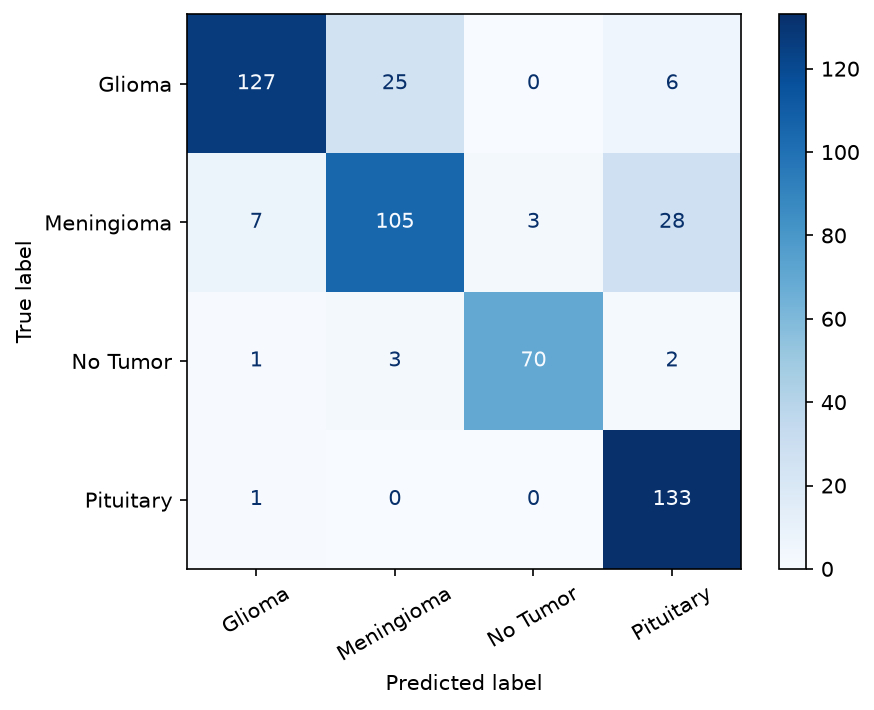
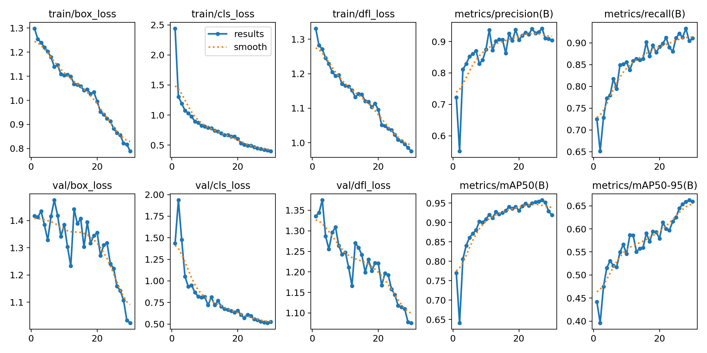
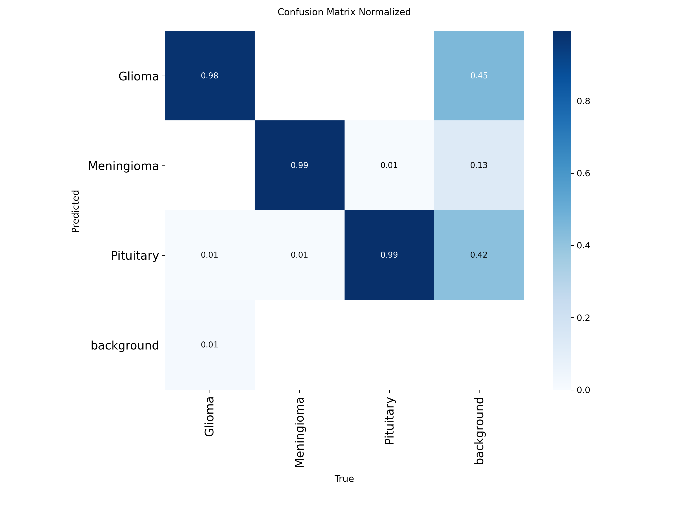

# Brain MRI Tumor Classification and Detection

Deep Learning prototype that classifies brain MRI images into 4 classes
(Glioma, Meningioma, No Tumor, Pituitary) and detects tumor regions with YOLOv8.

> **Warning:** this is an educational project. It is **not** a medical diagnosis tool.

## Dataset

"MRI for Brain Tumor with Bounding Boxes" (Kaggle): 5,249 MRI images, YOLO-format boxes,
4 classes. Download it from Kaggle and put it in `data/` (folders `Train/` and `Val/`).
The data is not stored in this repository.

### Data cleaning (notebook `01_exploration`)

| Problem found | Action |
|---|---|
| 15 images whose folder class and box class disagree | Removed |
| 2 images without label + 1 empty label | Removed |
| 1,331 exact duplicate images (md5 hash), 213 groups shared by Train and Val (data leakage) | Kept one copy, Val copy first |
| 257 images with boxes of several classes | Kept (known limit) |
| "No Tumor" boxes cover the whole brain | Used for classification only, not for detection |
| 0 corrupted images | |

Final dataset: 3,900 unique images. Split: **train 2,893 / val 496 / test 511**
(stratified, `random_state=42`). The test set was used one time, at the end.

## Models

### 1. Classification (notebook `03_classification_transfer_learning`)
MobileNetV2 (ImageNet) + GlobalAveragePooling + Dropout + Dense(4).
Step 1: frozen base, train the head. Step 2: fine-tune the last 30 layers (lr 1e-5, BatchNorm frozen).
Callbacks: EarlyStopping, ModelCheckpoint, ReduceLROnPlateau.

Two configurations compared on the validation set:

| Config | Dropout | L2 | Val accuracy | Val macro F1 |
|---|---|---|---|---|
| Head only | 0.3 | none | 0.746 | 0.750 |
| **A (chosen)** | 0.3 | none | **0.867** | **0.871** |
| B | 0.5 | 1e-4 | 0.845 | 0.850 |

**Test result (config A):** accuracy 0.851, macro F1 0.861.

| Class | Precision | Recall | F1 |
|---|---|---|---|
| Glioma | 0.934 | 0.804 | 0.864 |
| Meningioma | 0.789 | 0.734 | 0.761 |
| No Tumor | 0.959 | 0.921 | 0.940 |
| Pituitary | 0.787 | 0.993 | 0.878 |



Main errors: Meningioma predicted as Pituitary (28 images), Glioma predicted as Meningioma (25).
Only 3 of 435 tumor images were predicted as "No Tumor".

### 2. Detection (YOLOv8n, trained on Kaggle GPU T4)
Tumor classes only (Glioma, Meningioma, Pituitary). 30 epochs, image size 512, moderate augmentation.

| Split | Precision | Recall | mAP50 | mAP50-95 |
|---|---|---|---|---|
| Val | 0.904 | 0.902 | 0.928 | 0.661 |
| **Test** | 0.851 | 0.883 | **0.888** | **0.632** |

Test mAP50 per class: Glioma 0.904, Meningioma 0.944, Pituitary 0.816.




## Limits
- Some images have boxes of several classes, which may be annotation noise.
- Only exact duplicates were removed. Resized or flipped copies may still exist.
- Some predicted boxes with no real box may be missing annotations in the dataset.
- Small test set (435 to 511 images): results can change by a few points.
- Not validated by a doctor. Not for medical use.

## Project structure
```text
projet-mri-deep-learning/
├── data/            (not in repo)
├── notebooks/
├── src/
├── models/
├── results/
├── dashboard/       (TODO)
├── dags/            (TODO)
├── tests/           (TODO)
├── Dockerfile       (TODO)
├── docker-compose.yml (TODO)
├── requirements.txt
└── README.md
```

## Installation and run
TODO: add after Streamlit, Airflow, and Docker are done.